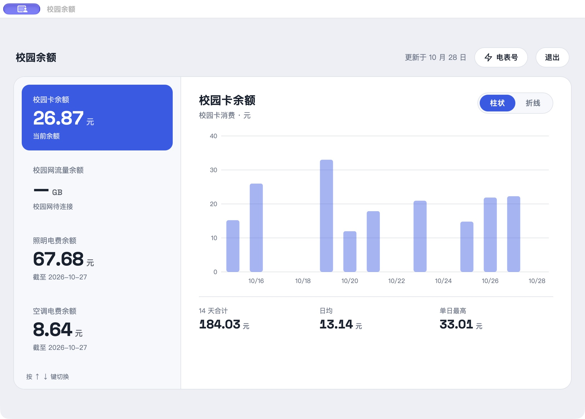
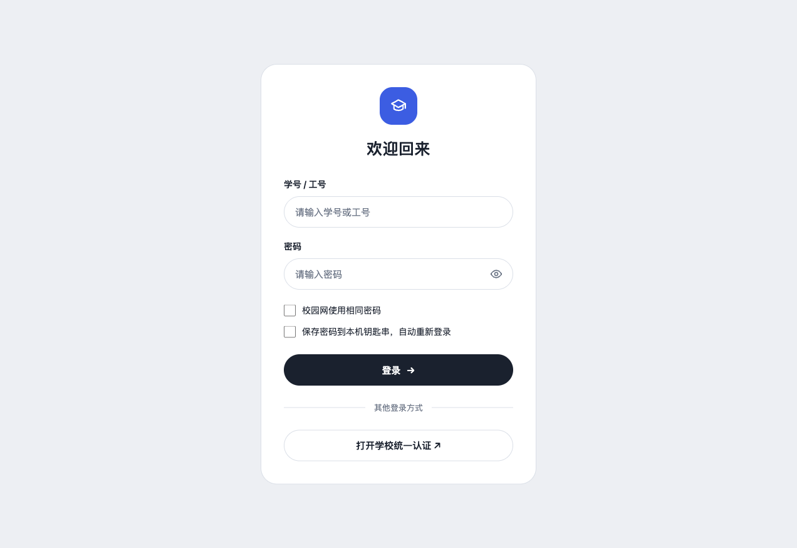

# 校园余额

在 Mac 上查看北航校园卡、校园网流量和宿舍电费。一个面板，了解余额和近期使用情况。

[下载 macOS 版](https://github.com/fyzzzz05/buaa-campus-balance/releases/latest) · [查看更新记录](https://github.com/fyzzzz05/buaa-campus-balance/releases)



<details>
<summary>查看登录界面</summary>



</details>

## 功能

- **校园卡**：查看余额和消费流水，按天展示消费金额。
- **校园网**：查看流量余额、本期用量和按学校结算日汇总的流量。
- **电费**：分别查看照明与空调余额，以及根据历史余额变化估算的每日消耗。
- **趋势**：点击左侧项目或使用上下方向键切换；支持柱状图和折线图。
- **电表设置**：填写自己的照明和空调电表号，可选接入自己的电费监控历史。

## 安装与使用

1. 从 [Releases](https://github.com/fyzzzz05/buaa-campus-balance/releases/latest) 下载 `CampusBalance-macOS-arm64.zip`，解压并打开「校园余额」。需要 Apple 芯片 Mac 和 macOS 13.5 或更新版本。
2. 在能够访问学校服务的网络中登录。可以在应用内填写统一身份认证账号和密码，或者选择「打开学校统一认证」到学校页面登录。
3. 点击右上角「电表号」，填写自己的照明和空调电表号。电表号可通过北航总务公众号查询；目前不能仅凭楼栋和房间自动查找。

学校页面登录不会将密码交给应用，因此不会自动连接校园网。若要查看校园网流量，可使用账号密码方式登录，并在密码相同时勾选「校园网使用相同密码」。

应用尚未使用 Apple Developer ID 签名和 Apple 公证，首次打开可能出现 macOS 验证提示。

## 数据说明

- 校园卡消费来自学校流水，校园网用量按学校结算数据统计。数据更新可能有延迟。
- 电费图表根据相邻日期的余额减少量估算，充值或缺少记录时不能等同于实际消费流水。
- 学校电表服务不可用时，可在电表设置的「其他设置」中填写自己的 GitHub 用户名，读取该用户 `buaa-electricity-monitor` 仓库中公开的 `main/data/history.csv`。历史记录的电表号必须与设置一致。

## 隐私与登录

应用的服务只监听本机 `127.0.0.1`，请勿直接暴露到公网。账号密码不会写入项目文件；选择自动重新登录后，密码会保存在 macOS 登录钥匙串，在学校会话失效时按需读取。退出面板会删除保存的密码；学校要求验证码或其他验证时仍需手动登录。

电表设置和本地数据保存在当前用户的 `~/Library/Application Support/CampusBalance`。不同账号的设置相互独立。

## 更新

安装支持更新的版本后，可在 macOS 左上角选择「校园余额 → 检查更新…」。更新由 GitHub Releases 分发，更新包和更新描述使用 Ed25519 签名。自动构建工作流已配置，完整的自动构建与应用内安装流程仍需进一步验证。

## 本地开发

需要 Node.js 22 或更新版本，以及可以访问学校服务的网络。

```sh
npm ci
./start-web.command
```

打开 `http://127.0.0.1:4174`。macOS 用户也可以双击 `start-web.command`。网页模式可以使用账号密码登录；跳转学校页面后自动返回应用的登录方式仅在 macOS App 中提供。

运行测试：

```sh
npm test
```

## 许可

[ISC License](LICENSE)
